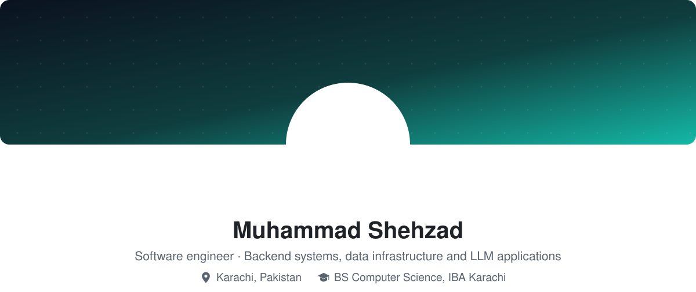

<picture>
  <source media="(prefers-color-scheme: dark)" srcset="assets/header-dark.svg">
  
</picture>

&nbsp;

---

## 👨‍💻 About me

Software engineer at **SecurePath**. I built **Morpheus**, an internal console that brings Kubernetes, RabbitMQ, databases, container image scans and Sentry errors into one view of every service across 13 environments. I also work on accounting, billing and release testing for the company's main Go and React platform.

Previously an AI and data engineer at **QLU.ai**, where I built a model-agnostic text-to-SQL engine and moved 200 GB of analytics from Postgres to ClickHouse.

I work daily with Claude Code and other AI coding agents.

---

## 🚀 Featured work

> Most of this is company work, so the code is private.

### Morpheus

An internal console that shows how every service at SecurePath is running, in one place.

        

- One read-only view of 2 clusters and 13 environments: pods, queues, databases, object storage, image CVEs and errors.
- Alerts in Google Chat the moment a service goes down, so the team hears about it before users do.
- Service catalog and dependency map that show which service reads which queue and where a link is broken.
- Automatic hygiene checks: secrets set inline, images missing from the registry, stale builds, config typos.

### Accounting ledger and billing

The accounting and billing core of SecurePath's main platform.

    

- Double-entry ledger with database-enforced invariants; every money action is reversible and auditable.
- Invoice PDFs and emails, QuickBooks export, trial balance and receivables ageing.
- End-to-end release suites that run against dev and UAT before each production promotion.

### Text-to-SQL engine

Lets people ask a large database questions in plain English. Built at QLU.ai.

     

- Turns plain-English questions into SQL across multiple tables with 200+ columns, and returns a complete answer within 30 seconds.
- Model-agnostic: the same pipeline runs on GPT-4, Claude Opus or other models, chosen per deployment.
- Dashboards for token usage, query execution time and pipeline latency, which cut LLM cost by 30% and made queries 50% faster.
- Migrated 200 GB of analytical data from PostgreSQL to ClickHouse; queries became 10–100× faster.
- Took a 401M-row (106 GB) table from minutes to seconds with indexes and materialized views.

---

## 💼 Experience

| Company | Role | Location | When |
|:---|:---|:---|:---|
| &nbsp; [SecurePath Technologies](https://www.securepath.tech/) | Software Developer 1 | 🇺🇸 Remote, US | Jun 2026 – present |
| &nbsp; [EdgeFirm](https://www.edgefirm.io/) | Software Developer | 🇵🇰 Onsite, Karachi, Pakistan | May – Aug 2026 |
| &nbsp; [QLU.ai](https://www.qlu.ai/) | AI & Data Engineer | 🇵🇰 Onsite, Karachi, Pakistan | Jun 2025 – May 2026 |
| &nbsp; [Securiti.ai](https://securiti.ai/) | Backend Intern, Data Catalog | 🇵🇰 Onsite, Karachi, Pakistan | Jun – Aug 2024 |

---

## 🛠️ Toolkit

| Area | Tools |
|---|---|
| Languages | Go, TypeScript, Python, SQL |
| Backend | Go Fiber, NestJS, FastAPI, REST, gRPC |
| Data | PostgreSQL, ClickHouse, Redis, RabbitMQ, Qdrant |
| LLMs | OpenAI, Anthropic and Gemini APIs, RAG, structured output |
| Platform | Kubernetes, Docker, GitHub Actions, Sentry, AWS, GCP |
| Testing | Go tests, Vitest, Playwright |

---

